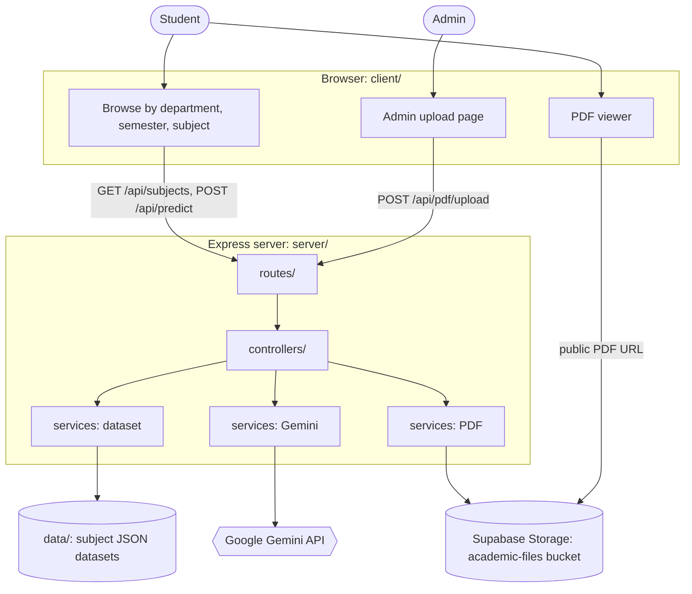
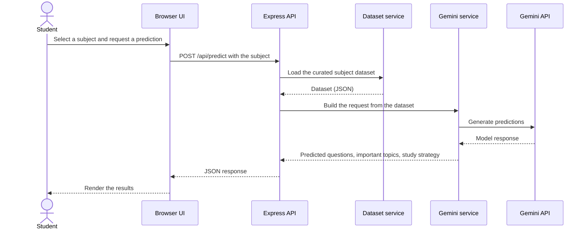
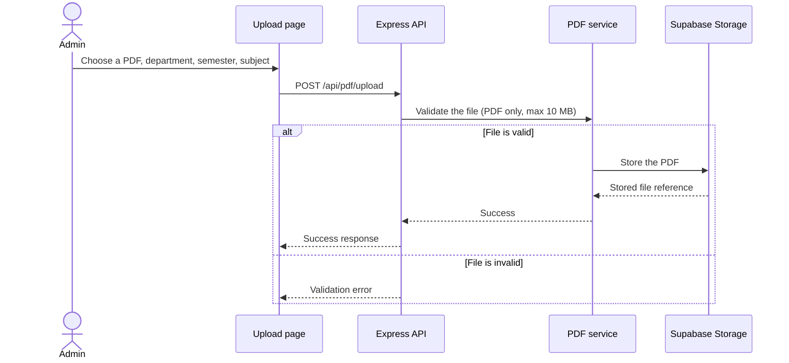

<div align="center">

# ExamForge

**An AI-powered exam-preparation platform: browse previous-year papers and generate subject-wise question predictions, important topics, and study strategies.**

[](https://exam-forge-coral.vercel.app/)


<!-- STEP 1 (after adding the file): uncomment this hero image.

-->

</div>

## Table of Contents

- [About](#about)
- [Demo](#demo)
- [Features](#features)
- [Architecture](#architecture)
- [Tech Stack](#tech-stack)
- [Getting Started](#getting-started)
- [Scripts](#scripts)
- [API Reference](#api-reference)
- [Project Structure](#project-structure)
- [Testing](#testing)
- [Roadmap](#roadmap)
- [Author](#author)

## About

Preparing for exams means hunting for previous-year papers and guessing which topics matter most. ExamForge puts both in one place: students browse papers by department, semester, and subject, and request AI-generated predictions, important topics, and study strategies for a subject.

<!-- STEP 2 (after adding your files): uncomment this whole Demo section and delete this comment.

## Demo

### Video walkthrough

Paste the link GitHub gives you after dragging your .mp4 into the README editor, on its own line. It will render as an inline player:

https://github.com/user-attachments/assets/REPLACE-WITH-YOUR-VIDEO-ID

If the video is too large for GitHub, upload it to YouTube and use a clickable thumbnail instead:

[](https://www.youtube.com/watch?v=REPLACE_ME)

### Screenshots

| Browse by department, semester, subject | AI predictions and study strategy |
|:---:|:---:|
|  |  |
| **Subject PDF viewer** | **Admin PDF upload** |
|  |  |

-->

## Features

- Department, semester, and subject browsing
- Previous-year paper links and solution placeholders
- Gemini-powered predictions from curated JSON datasets
- Admin PDF upload with PDF-only validation and a 10 MB size limit
- Subject-specific PDF viewer backed by Supabase Storage
- Health-check and subject-discovery APIs

## Architecture

ExamForge is a single Express.js server that serves both the REST API and the static frontend. The backend is layered (routes, controllers, services) so HTTP handling stays separate from the dataset, Gemini, and storage integrations.

### System overview



### Prediction flow

<!-- VERIFY this flow against server/controllers and server/services before pushing. -->



### Admin upload flow

<!-- VERIFY this flow against server/services (PDF service) before pushing. -->



### Key design decisions

- **Same-origin serving:** Express serves the API and the frontend together, so the browser uses the same relative API URLs locally and in production, with no cross-origin setup.
- **Layered backend:** Routes map to controllers, and controllers call services, which keeps request handling separate from Gemini, dataset, and storage logic.
- **Curated datasets:** Predictions are generated from per-subject JSON datasets in `server/data/`.
- **Storage safety:** Papers live in a public, PDF-only Supabase bucket with a 10 MB limit. The secret key is needed only when uploading and is never added to browser code or committed to Git.

## Tech Stack

| Layer | Technology |
|---|---|
| Frontend | HTML, CSS, JavaScript |
| Backend | Node.js 20+, Express.js, REST APIs |
| AI | Google Gemini API |
| Storage | Supabase Storage (public, PDF-only bucket) |
| Deployment | Vercel |
| Tooling | Git/GitHub, npm scripts, automated API and upload tests |

## Getting Started

**Requirements:** Node.js 20 or newer and a Gemini API key.

```bash
git clone https://github.com/kritika89898/ExamForge.git
cd ExamForge/server
npm install
cp .env.example .env        # Windows (cmd): copy .env.example .env
npm run dev
```

Set `GEMINI_API_KEY` in `server/.env`, then open <http://localhost:5000>.

### Configuration

| Variable | Required | Purpose |
|---|---|---|
| `GEMINI_API_KEY` | Yes | Generates predictions |
| `SUPABASE_URL` | For hosted papers | Locates the public `academic-files` bucket |
| Supabase secret key (see `.env.example`) | Only when uploading | Used by the upload tooling. Never commit it or expose it to the browser. |

For the bucket, upload, and deployment procedure, see [`docs/supabase-storage.md`](docs/supabase-storage.md).

## Scripts

Run these from the `server` directory:

| Command | What it does |
|---|---|
| `npm start` | Starts the production server |
| `npm run dev` | Starts the server with automatic reloads |
| `npm test` | Runs the API and upload regression tests |
| `npm run storage:setup` | Creates or updates the public PDF-only bucket |
| `npm run storage:upload -- <local-pdf> <storage-path>` | Uploads one prepared PDF to the configured bucket |

## API Reference

| Method | Endpoint | Purpose |
|---|---|---|
| `GET` | `/api/health` | Deployment health check |
| `GET` | `/api/subjects` | List subjects with local datasets |
| `POST` | `/api/predict` | Generate a prediction from `{ "subject": "DBMS" }` |
| `POST` | `/api/pdf/upload` | Upload a PDF with department, semester, and subject fields |

## Project Structure

```
client/            Browser UI and admin upload page
docs/              Storage setup and operating instructions
server/
  controllers/     HTTP request handlers
  data/            Subject datasets used for predictions
  routes/          Express API routes
  services/        Dataset, PDF, and Gemini integrations
  scripts/         Controlled Supabase bucket and upload tooling
```

## Testing

```bash
cd server
npm test
```

The suite covers the API endpoints and the PDF upload rules.

## Roadmap

- [ ] Expand the verified paper catalog semester by semester
- [ ] Add admin authentication before accepting uploads
- [ ] Replace placeholder paper links with stored, searchable documents
- [ ] Add rate limiting and caching around AI prediction requests

## Author

**Kritika Bhanaria**: [GitHub](https://github.com/kritika89898)
