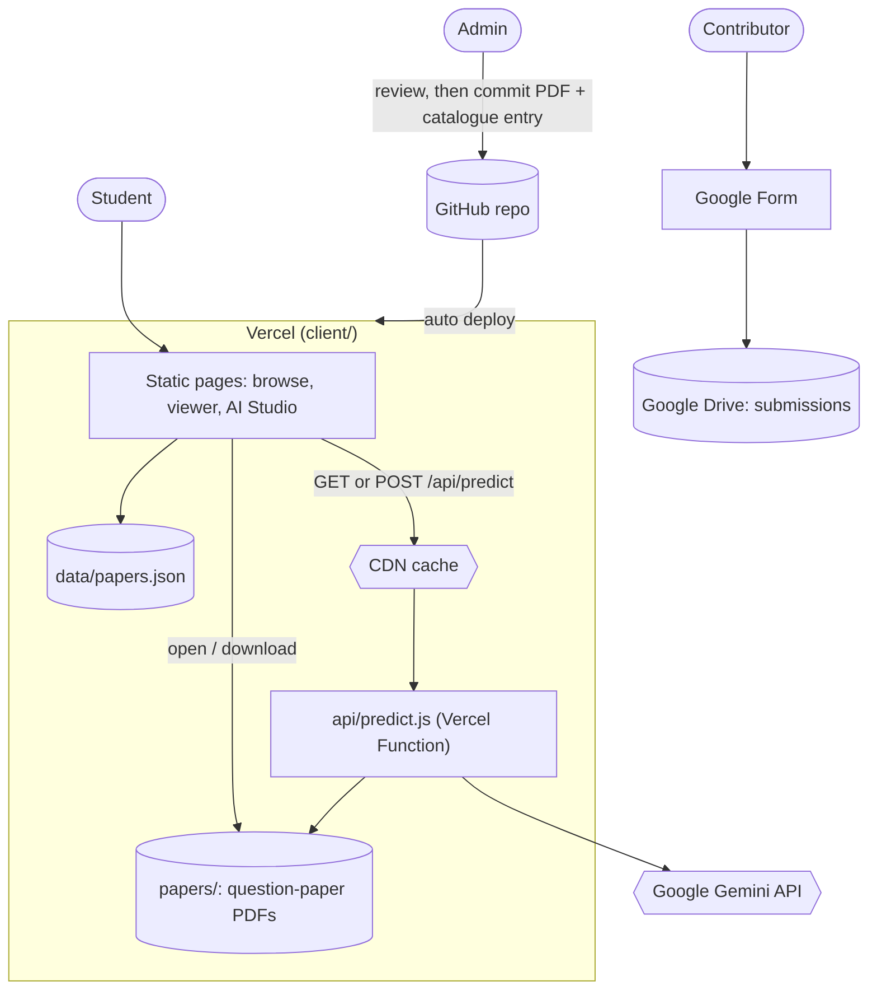
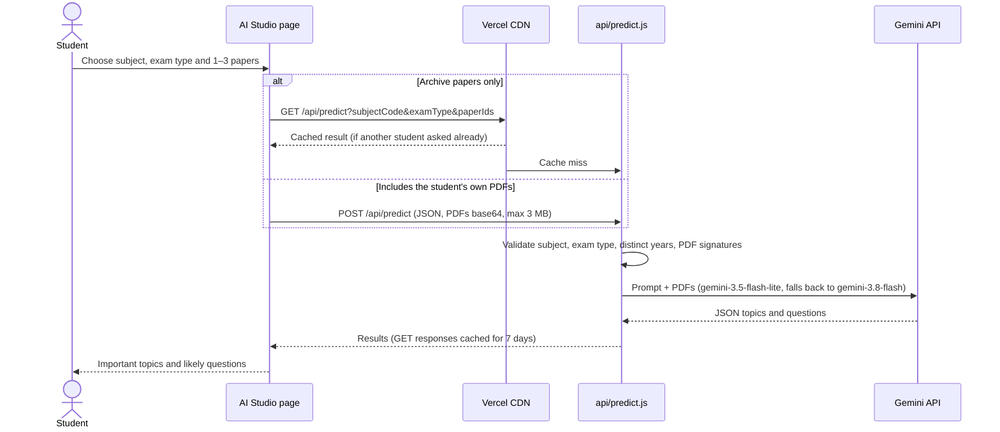

<div align="center">

# ExamForge

**An AI-powered exam-preparation platform: browse previous-year papers and generate subject-wise question predictions, important topics, and study strategies.**

[](https://exam-forge-coral.vercel.app/)


<!-- STEP 1 (after adding the file): uncomment this hero image.

-->

</div>

## Table of Contents

- [About](#about)
- [Demo](#demo)
- [Features](#features)
- [Architecture](#architecture)
- [Tech Stack](#tech-stack)
- [Getting Started](#getting-started)
- [Scripts](#scripts)
- [API Reference](#api-reference)
- [Project Structure](#project-structure)
- [Testing](#testing)
- [Roadmap](#roadmap)
- [Author](#author)

## About

Preparing for exams means hunting for previous-year papers and guessing which topics matter most. ExamForge puts both in one place: students browse papers by department, semester, and subject, and request AI-generated predictions, important topics, and study strategies for a subject.

<!-- STEP 2 (after adding your files): uncomment this whole Demo section and delete this comment.

## Demo

### Video walkthrough

Paste the link GitHub gives you after dragging your .mp4 into the README editor, on its own line. It will render as an inline player:

https://github.com/user-attachments/assets/REPLACE-WITH-YOUR-VIDEO-ID

If the video is too large for GitHub, upload it to YouTube and use a clickable thumbnail instead:

[](https://www.youtube.com/watch?v=REPLACE_ME)

### Screenshots

| Browse by department, semester, subject | AI predictions and study strategy |
|:---:|:---:|
|  |  |
| **Subject PDF viewer** | **Contribute page** |
|  |  |

-->

## Features

- Browse 76 verified previous-year papers by branch, semester and subject (CSE-AI, Semesters 4–6), including electives
- In-browser PDF viewer with open and download links
- **AI Studio:** pick 1–3 papers of one exam type (archive papers or your own PDFs) and get important topics and likely questions from Google Gemini
- Community contributions through a Google Form, reviewed before anything is published
- Runs entirely on free tiers: no database or paid storage

## Architecture

The site is static HTML, CSS and JavaScript in `client/`, deployed on Vercel. Question papers are ordinary files in `client/papers/`, served from Vercel's CDN, so they are always available. AI Studio is one Vercel Function, `client/api/predict.js`, with no npm dependencies.

### System overview



### AI Studio flow



### Key design decisions

- **Static files over a storage service:** about 60 MB of PDFs fit comfortably in the repo. Vercel serves them from its CDN, so there is no free-tier database that can pause or expire.
- **Zero-dependency function:** `api/predict.js` calls the Gemini REST API with `fetch`, so the function needs no `npm install`.
- **Quota-friendly AI:** archive-only analyses use `GET` and are cached on the CDN for a week; a model that is out of quota falls back to the next one.
- **Fits Vercel's 4.5 MB request limit:** archive PDFs are read inside the function, and student uploads are capped at 3 MB in total.
- **Moderated contributions:** submissions go to a private Google Drive folder through a Google Form and are published only after review.

## Tech Stack

| Layer | Technology |
|---|---|
| Frontend | HTML, CSS, JavaScript, PDF.js |
| API | Vercel Functions (Node.js), Express.js for local development |
| AI | Google Gemini API (REST) |
| Paper storage | Static files in the repo, served by Vercel's CDN |
| Contributions | Google Forms + Google Drive |
| Deployment | Vercel |
| Tooling | Git/GitHub, Node's built-in test runner |

## Getting Started

**Requirements:** Node.js 20 or newer and a free Gemini API key from <https://aistudio.google.com/apikey>.

```bash
git clone https://github.com/kritika89898/ExamForge.git
cd ExamForge/server
npm install
cp .env.example .env        # Windows (cmd): copy .env.example .env
npm run dev
```

Set `GEMINI_API_KEY` in `server/.env`, then open <http://localhost:5000>. The local Express server runs the same `client/api/` handlers that Vercel runs in production.

### Configuration

| Variable | Required | Purpose |
|---|---|---|
| `GEMINI_API_KEY` | Yes, for AI Studio | Google Gemini key. On Vercel, add it under Project Settings → Environment Variables. |
| `GEMINI_MODEL` | No | Comma-separated models to try in order. Default: `gemini-3.5-flash-lite,gemini-3.8-flash` |

### Deploying on Vercel

Set the project's **Root Directory** to `client`. `client/vercel.json` bundles the papers and catalogue with the AI function.

## Adding a contributed paper

1. Open the submission in the Google Form's linked Drive folder and check the subject, year and exam type.
2. Rename the PDF like the others, e.g. `BAI301_ML_END_2026.pdf`, and put it in `client/papers/semester-N/`.
3. Add an entry to `client/data/papers.json` with its `file_path`, `file_size` and `checksum_sha256`.
4. Commit and push. Vercel redeploys automatically.

## Scripts

Run these from the `server` directory:

| Command | What it does |
|---|---|
| `npm run dev` | Local server with automatic reloads |
| `npm start` | Local server without reloads |
| `npm test` | Catalogue, AI Studio and page tests |

## API Reference

| Method | Endpoint | Purpose |
|---|---|---|
| `GET` | `/api/health` | Health check; reports whether the Gemini key is configured |
| `GET` | `/api/predict?subjectCode=&examType=&paperIds=a,b,c` | Analyse 1–3 archive papers (CDN-cached) |
| `POST` | `/api/predict` | Analyse papers including the student's own PDFs: `{ subjectCode, examType, paperIds, uploads: [{ name, year, data }] }` |

## Project Structure

```
client/
  api/             Vercel Functions: predict.js, health.js
  admin/           Contribute page (links to the Google Form)
  data/            papers.json catalogue and curriculum map
  papers/          Question-paper PDFs by semester
  vercel.json      Function settings
server/
  server.js        Local Express server mounting client/api handlers
  test.js          Test suite
  scripts/         PDF splitting helper
```

## Testing

```bash
cd server
npm test
```

The suite checks that every catalogue entry has a matching PDF (size and SHA-256), the curriculum map, AI Studio validation, model fallback, CDN caching headers and the Contribute page link. Gemini is stubbed, so no API key is needed.

## Roadmap

- [ ] Expand the verified paper catalogue to more branches and semesters
- [ ] A small script to add a reviewed paper to the catalogue automatically
- [ ] Rate limiting for uploaded-PDF analyses

## Author

**Kritika Bhanaria**: [GitHub](https://github.com/kritika89898)
