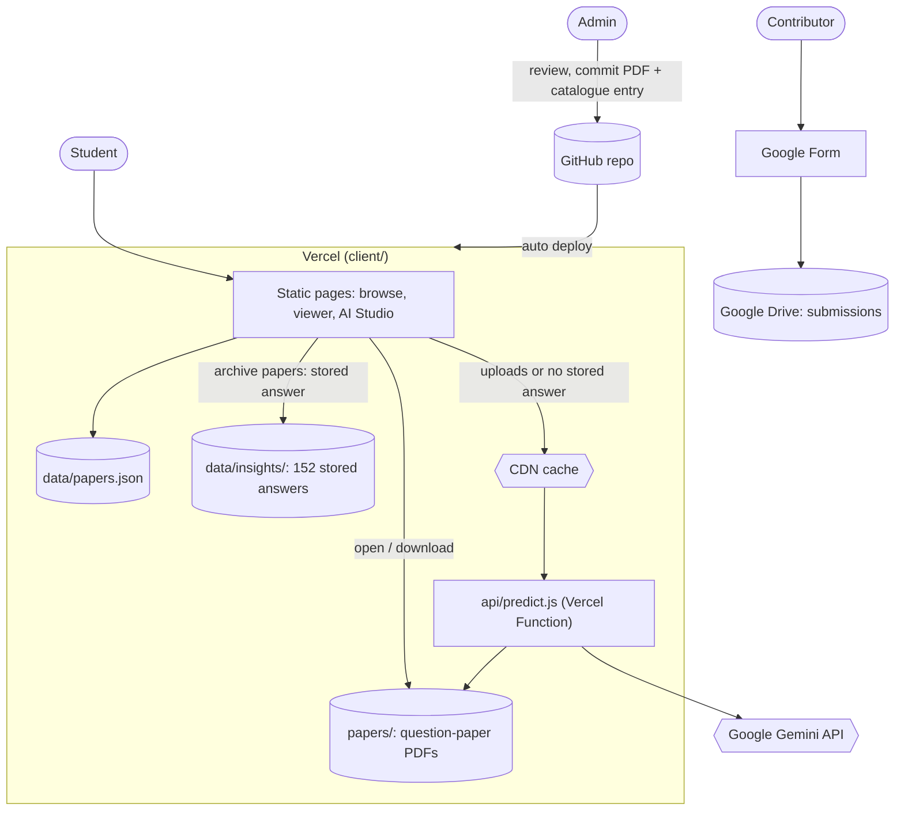
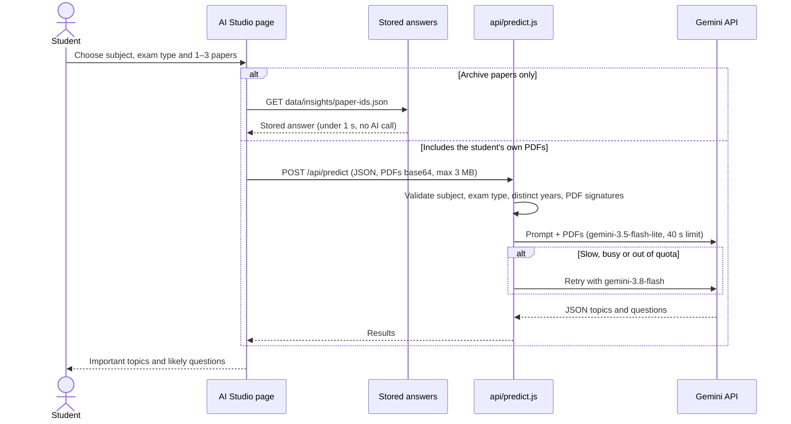

<div align="center">

# ExamForge

**Previous-year IGDTUW exam papers in one place, plus an AI Studio that finds the important topics and likely questions from them.**

[](https://exam-forge-coral.vercel.app/)
[](https://youtu.be/0jvvX_hamBg)


</div>

## Demo

[](https://youtu.be/0jvvX_hamBg)

▶ **[Watch the walkthrough on YouTube](https://youtu.be/0jvvX_hamBg)**  ·  🌐 **[Try it live](https://exam-forge-coral.vercel.app/)**

## Table of Contents

- [About](#about)
- [Features](#features)
- [Highlights](#highlights)
- [Architecture](#architecture)
- [Tech Stack](#tech-stack)
- [Getting Started](#getting-started)
- [Adding a contributed paper](#adding-a-contributed-paper)
- [API Reference](#api-reference)
- [Project Structure](#project-structure)
- [Testing](#testing)
- [Roadmap](#roadmap)
- [Author](#author)

## About

Preparing for semester exams usually means hunting through group chats for old papers and guessing which topics matter. ExamForge puts verified previous-year papers in one place, organised by branch, semester and subject, and adds an **AI Studio** that reads up to three years of papers and returns the topics that keep coming back and the questions most likely to appear.

The whole site runs on free tiers: no database, no paid storage, and nothing that sleeps when traffic is low.

## Features

**Paper archive**
- **76 verified papers** across **16 subjects** (B.Tech CSE-AI, Semesters 4–6), including electives, with Mid and End Semester papers from 2022–2025
- Curriculum map for all **7 IGDTUW B.Tech branches** and 8 semesters, taken from the official syllabus documents
- Search by subject name or code, and filters for subjects with papers or core courses
- In-browser PDF viewer (PDF.js, with the browser's own viewer as a fallback), plus open and download links

**AI Studio**
- Pick **1 to 3 papers** of one subject and exam type from different years, from the archive or your own PDFs
- Returns about **8 important topics and 10 likely questions**, grounded only in the supplied papers, with no "guaranteed question" claims
- **Instant answers for archive papers:** all 152 possible archive paper combinations have a stored answer that loads in under a second and uses no AI quota
- Your own uploads are analysed live by Google Gemini in a few seconds, with a progress timer, and are never added to the archive

**Contributions**
- Students submit papers through a [Google Form](https://forms.gle/g3nsTYhQQ3k7Aat38); submissions land in a private Drive folder and are published only after review

## Highlights

| Problem | How ExamForge handles it |
|---|---|
| Free databases pause after inactivity, so papers stopped opening | PDFs are static files in the repo, served by Vercel's CDN; nothing can sleep |
| The Gemini free tier has a small daily quota | Stored answers for all 152 archive combinations, plus a 7-day CDN cache, so quota is only used for student uploads |
| Gemini is occasionally slow or out of quota | Each model gets 40 s, then the function falls back from `gemini-3.5-flash-lite` to `gemini-3.8-flash`; students see a live timer and a clear message instead of a frozen page |
| Vercel rejects request bodies over 4.5 MB | Archive PDFs are read inside the function, and student uploads are capped at 3 MB in total |
| Models get retired | Models are configurable through the `GEMINI_MODEL` environment variable, with no code change needed |
| Spam or wrong papers in contributions | Google Form with authenticity and consent checks; nothing is published without review |

## Architecture

The frontend is static HTML, CSS and JavaScript in `client/`, deployed on Vercel. Papers are ordinary files in `client/papers/`, and AI Studio is a single Vercel Function, `client/api/predict.js`, with **no npm dependencies**: it calls the Gemini REST API with `fetch`.

### System overview



### AI Studio flow



### Key design decisions

- **Static files over a storage service:** about 60 MB of PDFs fit comfortably in the repo and are served from Vercel's CDN, so there is no free-tier database to pause or expire.
- **Pre-computed answers:** archive papers rarely change, so every 1–3 paper combination is analysed once and stored as JSON. Students get instant, consistent results, and the AI quota is kept for uploads.
- **Zero-dependency function:** `api/predict.js` uses only Node built-ins and `fetch`, so the function needs no `npm install` and has a tiny cold start.
- **Graceful degradation:** per-model timeouts, model fallback, a 100 s total budget inside Vercel's 120 s limit, and human-readable errors for quota, timeouts and oversized uploads.
- **Same code locally and in production:** the local Express server mounts the same `client/api/` handlers that Vercel runs.

## Tech Stack

| Layer | Technology |
|---|---|
| Frontend | HTML, CSS, JavaScript, PDF.js |
| API | Vercel Functions (Node.js); Express.js for local development |
| AI | Google Gemini API (REST): `gemini-3.5-flash-lite` with `gemini-3.8-flash` fallback |
| Paper storage | Static files in the repo, served by Vercel's CDN |
| Contributions | Google Forms + Google Drive |
| Deployment | Vercel (auto-deploy from GitHub) |
| Testing | Node's built-in test runner, with Gemini stubbed |

## Getting Started

**Requirements:** Node.js 20 or newer and a free Gemini API key from <https://aistudio.google.com/apikey>.

```bash
git clone https://github.com/kritika89898/ExamForge.git
cd ExamForge/server
npm install
cp .env.example .env        # Windows (cmd): copy .env.example .env
npm run dev
```

Set `GEMINI_API_KEY` in `server/.env`, then open <http://localhost:5000>.

### Configuration

| Variable | Required | Purpose |
|---|---|---|
| `GEMINI_API_KEY` | Yes, for live AI analysis | Google Gemini key. On Vercel, add it under Project Settings → Environment Variables (Production and Preview). |
| `GEMINI_MODEL` | No | Comma-separated models to try in order. Default: `gemini-3.5-flash-lite,gemini-3.8-flash` |

### Deploying on Vercel

Import the repo into Vercel, set the project's **Root Directory** to `client`, and add `GEMINI_API_KEY`. `client/vercel.json` bundles the papers and catalogue with the AI function. After deploying, `/api/health` should return `"aiConfigured": true`.

## Adding a contributed paper

1. Open the submission in the Google Form's Drive folder and check the subject, year and exam type.
2. Rename the PDF like the others, e.g. `BAI301_ML_END_2026.pdf`, and put it in `client/papers/semester-N/`.
3. Add an entry to `client/data/papers.json` with its `file_path`, `file_size` and `checksum_sha256`.
4. Commit and push; Vercel redeploys automatically.
5. Create stored AI answers for the new paper combinations, then commit the new files in `client/data/insights/`:
   ```bash
   cd server
   node scripts/generate-insights.js        # only creates missing answers
   ```

## API Reference

| Method | Endpoint | Purpose |
|---|---|---|
| `GET` | `/api/health` | Health check; reports whether the Gemini key is configured (never the key itself) |
| `GET` | `/api/predict?subjectCode=&examType=&paperIds=a,b,c` | Analyse 1–3 archive papers (CDN-cached for 7 days) |
| `POST` | `/api/predict` | Analyse papers including the student's own PDFs: `{ subjectCode, examType, paperIds, uploads: [{ name, year, data }] }` |

Stored answers are plain static files: `GET /data/insights/<sorted paper ids joined by __>.json`.

## Project Structure

```
client/
  api/             Vercel Functions: predict.js (AI Studio), health.js
  admin/           Contribute page (opens the Google Form)
  data/
    papers.json    Paper catalogue
    curriculum.js  Official curriculum map for 7 branches
    insights/      152 stored AI Studio answers
  papers/          Question-paper PDFs by semester
  vercel.json      Function settings (timeout, bundled files)
server/
  server.js        Local Express server mounting client/api handlers
  test.js          Test suite
  scripts/
    generate-insights.js   Creates stored AI answers for new papers
    split-2025-papers.py   Splits combined scans into per-subject PDFs
```

## Testing

```bash
cd server
npm test
```

**22 tests** cover:
- Every catalogue entry has a matching PDF (size and SHA-256) and every paper combination has a valid stored answer
- The curriculum map for all branches and semesters
- AI Studio validation: subject, exam type, 1–3 distinct years, spoofed PDFs and the 3 MB upload cap
- Model fallback on quota errors and timeouts, no retry on invalid requests, and CDN cache headers
- The Contribute page linking to the Google Form

Gemini is stubbed in tests, so no API key is needed.

## Roadmap

- [ ] Expand the verified catalogue to more branches and semesters
- [ ] A script that adds a reviewed paper to the catalogue (rename, checksum, entry) in one step
- [ ] Rate limiting for uploaded-PDF analyses
- [ ] Topic-frequency charts across years for each subject

## Author

**Kritika Bhanaria**, B.Tech CSE (Artificial Intelligence), IGDTUW · [GitHub](https://github.com/kritika89898)
